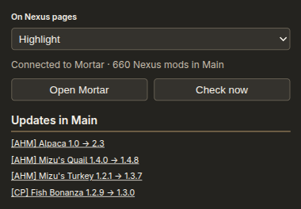

<h1 align="center">Mortar browser extension</h1>

<div align="center">


</div>

---

Chrome, Edge and Firefox companion for [Mortar](https://github.com/Rethunk-Tech/mortar). Relays Nexus Mod Manager Download clicks and Thunderstore package installs to the app on this computer, and marks what the open profile already has. Without Mortar the popup and options page say so; Nexus pages stay as Nexus drew them.

<p align="center"></p>

Install, protocol and the dev loop: [HUMANS.md](HUMANS.md). Layout and release: [AGENTS.md](AGENTS.md). Store listing copy: [docs/store/](docs/store/). Security: [SECURITY.md](SECURITY.md). Licence: AGPL-3.0, [LICENSE](LICENSE).

```sh
bun install && bun run gate
```
