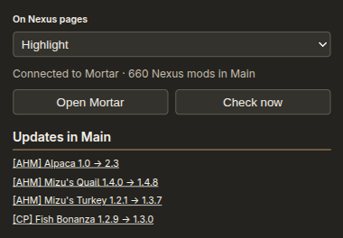

<h1 align="center">Mortar browser extension</h1>

<div align="center">


</div>

---

Chrome, Edge and Firefox companion for [Mortar](https://github.com/Rethunk-Tech/mortar). Relays Nexus Mod Manager Download clicks and Thunderstore, CurseForge, Vintage Story Mod DB, Paradox Mods and Modrinth installs to the app on this computer, and marks what the open profile already has. Without Mortar the popup and options page say so; Nexus pages stay as Nexus drew them.

<p align="center"></p>

## Quick start

```sh
bun install && bun run gate
```

Load the repo unpacked in Chrome or `about:debugging` in Firefox. Full install, protocol and the rest of the runbook: [HUMANS.md](HUMANS.md).

## Highlights

- Relays Nexus, Thunderstore, CurseForge, Vintage Story Mod DB, Paradox Mods and Modrinth installs to Mortar over native messaging (`tech.rethunk.mortar`)
- Marks mods the open Mortar profile already has on those sites
- Firefox self-distributed signed `.xpi` plus a public AMO listing; Chromium unpacked zip and a Web Store zip without the manifest `key`

## Documentation

| Doc                                | What                                       |
| ---------------------------------- | ------------------------------------------ |
| [HUMANS.md](HUMANS.md)             | Install, protocol, load unpacked, AMO sign |
| [AGENTS.md](AGENTS.md)             | Layout, release, invariants                |
| [CONTRIBUTING.md](CONTRIBUTING.md) | Commits and `bun run gate`                 |
| [SECURITY.md](SECURITY.md)         | Disclosure                                 |
| [docs/store/](docs/store/)         | Chrome, AMO and Edge paste guides          |
| [LICENSE](LICENSE)                 | AGPL-3.0                                   |

## License

AGPL-3.0. See [LICENSE](LICENSE). The popup and options use Atkinson Hyperlegible Next (SIL Open Font License, [fonts/OFL.txt](fonts/OFL.txt)).
